# Where every tab went

Source: `baseline/lib/nav_tree.py` (generated, not hand-written). Each of the 37 tabs from the old flat list appears exactly once. Simple mode shows the plain name; pages marked *advanced only* are hidden in Simple mode and shown in Advanced.

```mermaid
flowchart LR
  ROOT(["Baseline console"])
  ROOT --> n1["Home<br/><i>simple: Home</i>"]
  n1 --> n2["Home<br/><i>Home</i>"]
  n1 --> n3["Launcher<br/><i>Apps and computers</i>"]
  ROOT --> n4["Machine<br/><i>simple: This computer</i>"]
  n4 --> n5["Hardware<br/><i>About this computer</i>"]
  n4 --> n6["Sensors<br/><i>Temperatures and health</i>"]
  n4 --> n7["Network<br/><i>Internet and network</i>"]
  n4 --> n8["Audio and Bluetooth<br/><i>Sound and Bluetooth</i>"]
  n4 --> n9["Power<br/><i>Power</i>"]
  n4 --> n10["Memory and swap<br/><i>advanced only</i>"]
  n4 --> n11["Drive Administration<br/><i>Storage drives</i>"]
  ROOT --> n12["Workloads<br/><i>simple: Virtual computers</i>"]
  n12 --> n13["Virtual machines<br/><i>Virtual computers</i>"]
  n12 --> n14["Workspaces<br/><i>Workspaces</i>"]
  n12 --> n15["Environments<br/><i>Ready-made setups</i>"]
  n12 --> n16["Distro containers<br/><i>advanced only</i>"]
  n12 --> n17["Workload jobs<br/><i>advanced only</i>"]
  n12 --> n18["App Isolation<br/><i>advanced only</i>"]
  n12 --> n19["Ceph<br/><i>advanced only</i>"]
  ROOT --> n20["Tools<br/><i>simple: Help and tools</i>"]
  n20 --> n21["Chat<br/><i>Ask for help</i>"]
  n20 --> n22["Diagnostic tools<br/><i>Checkups</i>"]
  n20 --> n23["AI providers<br/><i>AI assistants</i>"]
  n20 --> n24["Console<br/><i>advanced only</i>"]
  ROOT --> n25["Security and access<br/><i>simple: Safety and access</i>"]
  n25 --> n26["Vault<br/><i>Passwords and keys</i>"]
  n25 --> n27["Two-factor<br/><i>Two-step sign-in</i>"]
  n25 --> n28["Operators<br/><i>People who can sign in</i>"]
  n25 --> n29["Approvals<br/><i>Waiting for your approval</i>"]
  n25 --> n30["Remote access<br/><i>Connect from elsewhere</i>"]
  n25 --> n31["Audit<br/><i>advanced only</i>"]
  ROOT --> n32["Recovery and backup<br/><i>simple: Backup and restore</i>"]
  n32 --> n33["Recovery<br/><i>Backup and restore</i>"]
  ROOT --> n34["Settings<br/><i>simple: Settings</i>"]
  n34 --> n35["Settings<br/><i>Settings</i>"]
  n34 --> n36["Web address<br/><i>Where Baseline is on your network</i>"]
  n34 --> n37["Admin<br/><i>advanced only</i>"]
  n34 --> n38["Operations<br/><i>advanced only</i>"]
  n34 --> n39["Master Config<br/><i>advanced only</i>"]
  ROOT --> n40["Installer<br/><i>simple: Set up and build</i>"]
  n40 --> n41[/"Plan and build"/]
  n41 --> n42["Installer plan<br/><i>Plan a build</i>"]
  n41 --> n43["Installation readiness<br/><i>Is it ready to install?</i>"]
  n41 --> n44["Installer desktop<br/><i>advanced only</i>"]
  n41 --> n45["Environment recipes<br/><i>advanced only</i>"]
  n40 --> n46[/"Cache"/]
  n46 --> n47["Installer Cache<br/><i>advanced only</i>"]
  n40 --> n48[/"Server managed"/]
  n48 --> n49["Managed server mode<br/><i>Connect to a parent server</i>"]
```

## Old tab -> new location

| # | Old tab | Route | New location (Advanced names) | Simple mode |
|---|---|---|---|---|
| 1 | Home | `/home` | Home > Home | Home |
| 2 | Launcher | `/launcher` | Home > Launcher | Apps and computers |
| 3 | Hardware | `/hardware` | Machine > Hardware | About this computer |
| 4 | Network | `/network` | Machine > Network | Internet and network |
| 5 | Sensors | `/sensors` | Machine > Sensors | Temperatures and health |
| 6 | Virtual machines | `/vms` | Workloads > Virtual machines | Virtual computers |
| 7 | Chat | `/chat` | Tools > Chat | Ask for help |
| 8 | Console | `/shell` | Tools > Console | hidden (advanced only) |
| 9 | Audio and Bluetooth | `/audio` | Machine > Audio and Bluetooth | Sound and Bluetooth |
| 10 | Power | `/power` | Machine > Power | Power |
| 11 | Memory and swap | `/memory` | Machine > Memory and swap | hidden (advanced only) |
| 12 | Workspaces | `/workspaces` | Workloads > Workspaces | Workspaces |
| 13 | Distro containers | `/containers` | Workloads > Distro containers | hidden (advanced only) |
| 14 | Environments | `/environments` | Workloads > Environments | Ready-made setups |
| 15 | Diagnostic tools | `/tools` | Tools > Diagnostic tools | Checkups |
| 16 | AI providers | `/ai-setup` | Tools > AI providers | AI assistants |
| 17 | Vault | `/vault` | Security and access > Vault | Passwords and keys |
| 18 | Two-factor | `/security` | Security and access > Two-factor | Two-step sign-in |
| 19 | Ceph | `/ceph` | Workloads > Ceph | hidden (advanced only) |
| 20 | Settings | `/settings` | Settings > Settings | Settings |
| 21 | Admin | `/admin` | Settings > Admin | hidden (advanced only) |
| 22 | Recovery | `/recovery` | Recovery and backup > Recovery | Backup and restore |
| 23 | Drive Administration | `/drive-admin` | Machine > Drive Administration | Storage drives |
| 24 | Operations | `/operations` | Settings > Operations | hidden (advanced only) |
| 25 | Operators | `/operators` | Security and access > Operators | People who can sign in |
| 26 | Approvals | `/approvals` | Security and access > Approvals | Waiting for your approval |
| 27 | Audit | `/audit` | Security and access > Audit | hidden (advanced only) |
| 28 | Remote access | `/remote-access` | Security and access > Remote access | Connect from elsewhere |
| 29 | Workload jobs | `/workloads` | Workloads > Workload jobs | hidden (advanced only) |
| 30 | Master Config | `/master-config` | Settings > Master Config | hidden (advanced only) |
| 31 | Installation readiness | `/installation-readiness` | Installer > Plan and build > Installation readiness | Is it ready to install? |
| 32 | Installer Cache | `/installer-cache` | Installer > Cache > Installer Cache | hidden (advanced only) |
| 33 | App Isolation | `/app-isolation` | Workloads > App Isolation | hidden (advanced only) |
| 34 | Environment recipes | `/recipes` | Installer > Plan and build > Environment recipes | hidden (advanced only) |
| 35 | Installer plan | `/install-plan` | Installer > Plan and build > Installer plan | Plan a build |
| 36 | Installer desktop | `/install-plan?display=desktop` | Installer > Plan and build > Installer desktop | hidden (advanced only) |

Not tabs, still in the bar: **Log out**, **Restart host** (unchanged). New in the bar: Simple/Advanced switch, Refresh now, status strip.

## New pages (did not exist in the old list)

- `/web-address` Web address
- `/managed-mode` Managed server mode

## Data elements kept

- Routes in the old web app: 116. Routes removed since the flat list: **0** . Routes added: 4.
- Every page body is rendered by the same function as before; only the navigation around it changed, plus the additions listed.
- `tests/unit/test_parity_manifest.py` fails if a TUI feature or installer function loses its console page; `tests/unit/test_nav_tree.py` fails if a page is missing or listed twice.
