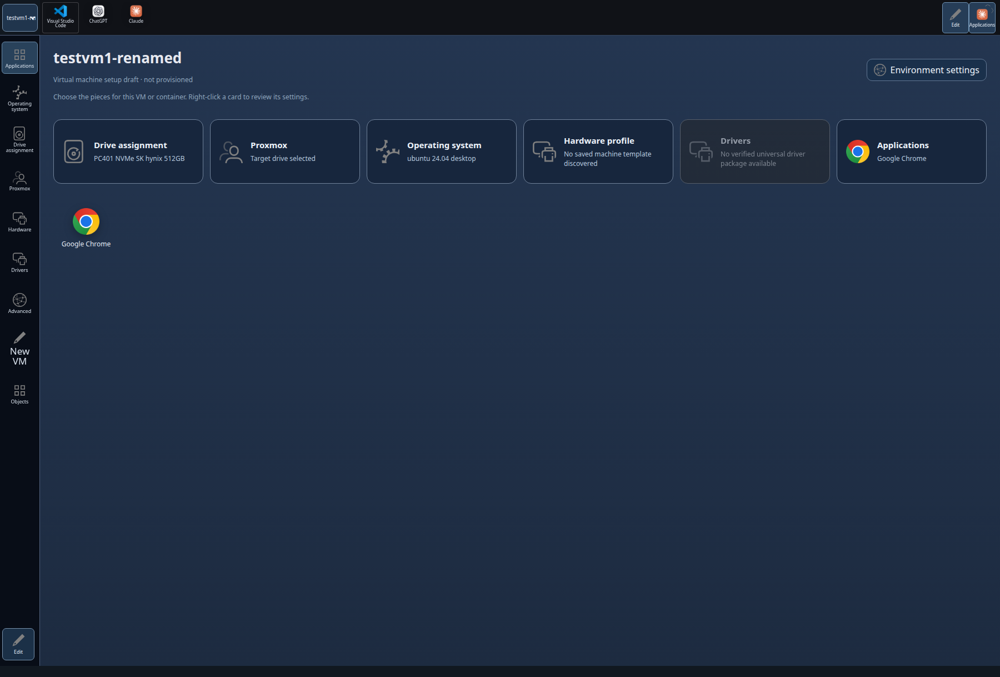
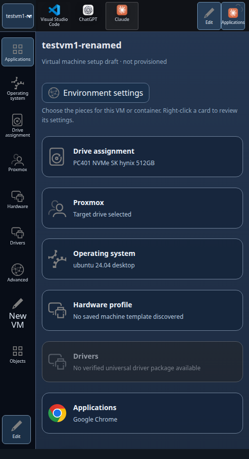
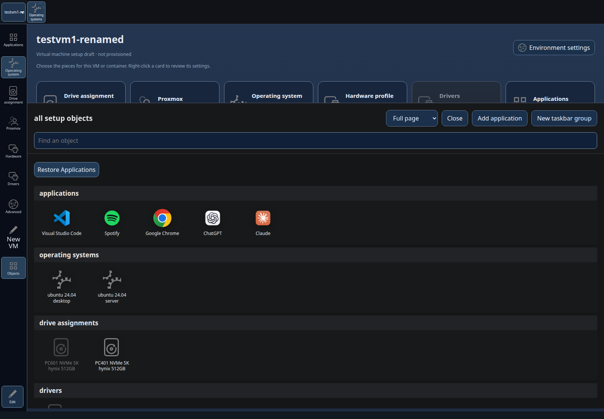
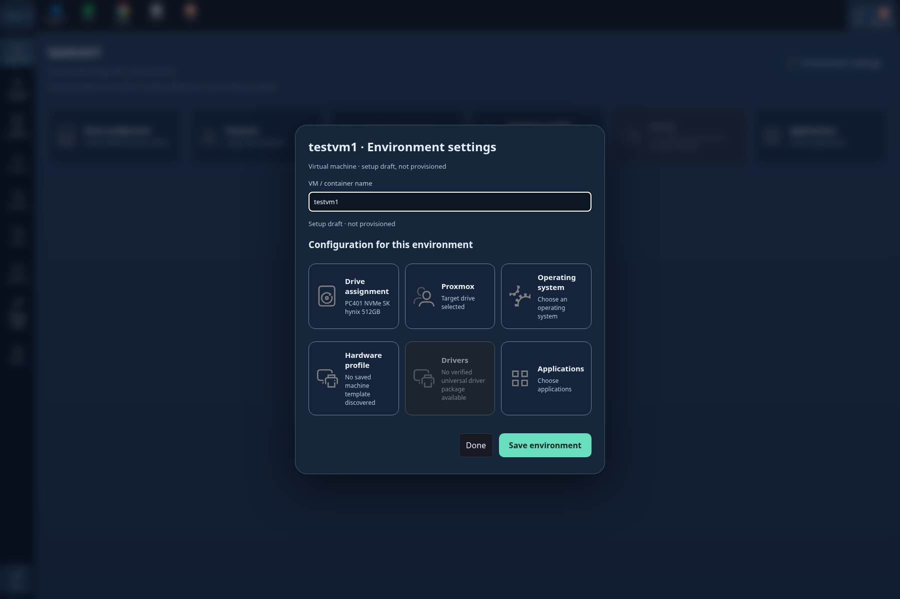

# DR172 browser evidence

The screenshots below are from the real Chromium integration test, served by
the local Installer with synthetic drive discovery and a synthetic privileged
executor. They show the desktop and 500px-wide phone layout. They are browser
evidence only; they do not show physical PC401 deployment or a running guest.

The integration check verifies that the desktop has no environment tab strip,
keeps unrelated admin/recovery links out of its rail, exposes seven relevant
setup groups and six environment blocks inside each environment settings modal, and opens Object Manager with all
types grouped. The Setup taskbar group shows six icons including a disabled
Drivers icon. The default environment is named `testvm1`, is labeled a draft, and saves through its modal. The drive block reads “Drive assignment.” The page fits phone width without horizontal overflow. The test
also exercises group swipe/hold and edit, VM/container creation and switching,
copy/move, and saved configuration. Result: PASS. The focused Installer/page
suite passed 22 tests.

No real storage or workload execution occurred. PC401 installation, Proxmox
boot/network/firewall, driver packaging, OS/application runtime, and overlay
persistence remain unverified.
