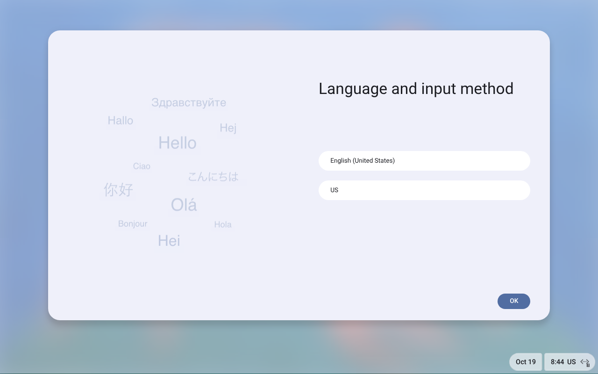

# FydeOS display verification — 2026-10-19

A clean build from the carried OVA, using the production builder and VM factory,
rendered language selection and welcome in real QEMU/KVM. A VNC click closed the
language dialog and rendered welcome; a reset rendered setup again. The prepared
base checksum remained unchanged. See DR314 for exact scope and unresolved work.

Artifacts: `/run/media/cane/CACHE/baseline-build/fydeos-repair/`.
`prepared/fydeos-base.json` records the exact source/image hash and proof scope.
`clean-argv.json` records the production VM arguments plus restricted networking
and a local Unix VNC endpoint. Source/fake Proxmox checks are separate from this
real QEMU visual check. Native PC601 Proxmox execution is unverified.

Physical deployment of code and prepared base is pending at this checkpoint;
any completed deployment report will be recorded below. This is not proof of a
configured FydeOS user account or its applications.
